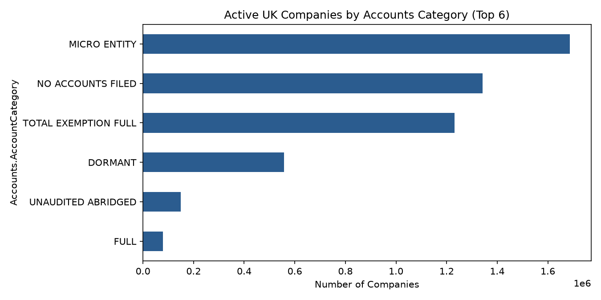
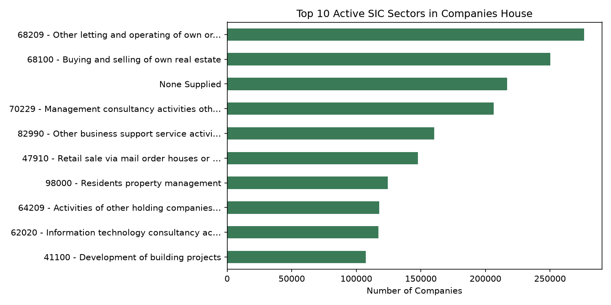

# UK VAT Identifier Discovery

## Repository Overview & Tech Stack

- **Data Analysis and Sampling (`eda.ipynb`):** Exploratory analysis of the 5.7 million row Companies House snapshot, empirical test of the UK Contracts Finder OCDS API, and generation of the 120-company stratified sample (`sample_companies.csv`).
- **Checksum Validation (`validator.py`):** Local UK VRN normalization and Modulus-97 / Modulus-97 (+55) check-digit validation.
- **HMRC Verification (`hmrc_verifier.py`):** Stateful session/CSRF client and HTML parser for HMRC's public VAT checker.
- **Discovery Pipeline (`pipeline.py`):** End-to-end domain resolution, subpage crawling, contextual VRN/EORI extraction, and entity reconciliation (`poc_results.csv`).
- **Tools & Libraries:** Python 3.14, `pandas`, `matplotlib`, `requests`, `beautifulsoup4`, `ddgs` (DuckDuckGo Search).
  

# Part 1: Research
## Domain and regulatory context

The task is to figure out whether a UK company VAT dataset can be built from the open web, then prove it using a sample. This is needed for a mid-sized manufacturing company that pays invoices to 40000 UK suppliers every month.

I decided to use the official public sector website of the United Kingdom government, **GOV.UK**, to research how this exchange between companies works. According to them, invoices should include: a unique identification number, the company name, address and contact information, the company name and address of the customer being invoiced, a clear description of what is being charged for, the date the goods or service were provided (supply date), the date of the invoice, the amount(s) being charged, the VAT amount if applicable, and the total amount owed. In the case of sole traders, their name and any business name being used, plus an address where any legal documents can be delivered if they are using a business name, must also be included.

However, what really interests us are **VAT invoices**, which are issued exclusively by a VAT-registered business. The VAT registration number is the only identifier that appears on both the invoice and the tax record, which makes matching an invoice to a supplier record easy. But the company’s procurement team only know the VAT number of a third of their suppliers, and they’re forced to guess for the rest using the name, which is rather unreliable.

Finding the name of UK companies is the easy part. The **Companies House “Free Company Data Product”** is a monthly updated dataset containing basic company data of live companies in the UK. While there is a lot of useful information we can get by analyzing it, the VAT numbers we’re looking for are unfortunately not there.

But what are VAT numbers anyway? Well, according to swiftvatpro.co.uk, the short answer is that a **UK VAT number** (often shortened as VRN) is a *unique tax identifier that must appear on every VAT invoice the business issues*, and customers need it to reclaim the VAT they are charged.
It is issued by **His Majesty’s Revenue and Customs (HMRC)** upon registration. Standard UK businesses receive a 9-digit number prefixed with GB, but branch registrations use 12 digits, with the last 3 identifying the branch.

One important thing to note is that the VRN is assigned independently of the company’s Companies House Registration Number (CRN), and there is no mathematical or public lookup mapping between the two.

HMRC does provide a web tool that allows you to **check if a UK VAT registration number is valid** and to find the name and address of the business the number is registered to. There’s also an API that can be used, but it requires formal developer registration with an approval wait time. Regardless, searching doesn’t work the other way around, due to taxpayer confidentiality rules.

While researching the VRN’s format, I’ve found that there’s a way to discard malformed VAT numbers by using its **built-in checksum**. Out of 9 digits, the last two are the check digits. By multiplying the first 7 digits individually by the weights 8, 7, 6, 5, 4, 3, and 2 respectively, summing all 7 products, then adding the two check digits, the result should be divisible by 97 for the VRN to be valid. Newer numbers use the same method, but with 55 added to the total first.

Probably the most important part of this research is figuring out *where to actually find the VAT numbers*. HMRC states that VAT numbers for most businesses and organisations can be found on their **invoices, receipts or website**. UK businesses that import or export goods also use an **Economic Operators Registration and Identification (EORI) number** formatted as GB + [9-digit VRN] + 000, so finding an EORI number on a customs or shipping page would reveal the VRN indirectly.

The problem is that many companies may not have a VRN at all for various reasons, so I decided to investigate why.

I have found that businesses have to register for VAT only if their VAT taxable turnover is more than £90,000. You must also be registered if you’re based outside the UK, your business is based outside the UK or if you supply any goods or services to the UK (or expect to in the next 30 days). However, you can make a “voluntary registration” for a VAT even if your turnover is less than £90,000, so we shouldn’t immediately eliminate smaller companies.

There are also goods and services that are **VAT-exempt or out of scope** in the UK (gov.uk/guidance/rates-of-vat-on-different-goods-and-services), including commercial property leasing, financial and insurance services, employee education/training, and statutory or postal fees. Even a mid-sized manufacturer regularly pays invoices to landlords, insurers, banks, and training providers, which means that some suppliers in the procurement team's list will never hold a VRN regardless of their size.

In this year’s annual report (Companies register activities: statistical release April 2025 to March 2026), it is stated that there were **5,479,045 companies** by March 31st, 2026. The effective register size, which does not include companies in the process of dissolution or liquidation, was 4,930,634 at the end of FYE 2026. There’s also the VAT annual statistics (the latest being the 2024 to 2025 report), in which it is said that there were **2,285,900 live VAT traders** at the end of FY 2024-2025. This figure covers all legal trader types, not just incorporated companies, so it includes sole traders, partnerships and non-profits.

What we can gather from this is that **fewer than half of live UK companies actually hold a VAT registration**. If we want to scrape the internet to find VAT numbers, one company’s VRN not being found could mean one of four things: the pipeline meant to find it failed, the business is below the £90,000 threshold, it operates exclusively in a VAT-exempt sector, or the company is inactive.

## Exploratory Data Analysis of the Companies House snapshot

I decided to take a closer look at the latest Companies House “Free Company Data Product” dataset next. There was the option to download it as multiple files, but seeing Excel load 849,999 rows for just one seventh of the dataset (the spreadsheet cap is at 1,048,576 rows), it became clear that relying on spreadsheet software was a dead end. Another reason why this approach was bad was that, in order to get an unbiased sample across the entire alphabet, I would need to have all the data in one place. I decided to process it as one big file using a Jupyter Notebook in VS Code instead.

Loading the full BasicCompanyDataAsOneFile-2026-11-01.csv snapshot (55 columns) in Python revealed several clear filtering signals for isolating plausible B2B suppliers:
- **Inactive & Non-Trading Entities (~1.16M records):** Out of 5,711,559 total rows, **532,303 (9.3%)** are not cleanly `Active` (417,325 are in `Active - Proposal to Strike off`, and ~115,000 are in liquidation, receivership, or administration). Among the **5,179,256** `Active` companies, another **623,597** file `DORMANT` accounts—meaning they had zero significant accounting transactions in the financial year and cannot exceed the £90,000 VAT threshold.
- **Unseasoned Entities (1,465,114 records):** Over a quarter of the register lists `NO ACCOUNTS FILED`. Because private limited companies have up to 21 months after incorporation to file their first accounts, this bucket consists largely of newly formed companies that lack an established trading history or web footprint.
- **Company Size Proxies (`Accounts.AccountCategory`):** Under UK reporting thresholds (effective April 2025), **Micro-entities** (turnover ≤ £1M, balance sheet ≤ £500k, or ≤ 10 employees) make up **1,877,415** records. This category straddles the £90,000 VAT threshold: it contains both VAT-registered small businesses and solo contractors operating below the threshold. Conversely, **Small and Mid-Sized/Large filers**—such as `TOTAL EXEMPTION FULL` (1,340,780), `UNAUDITED ABRIDGED` (165,563), `FULL` (86,629), `SMALL` (67,742), and `MEDIUM` (6,450)—represent established trading companies (up to £15M turnover for small companies) that are overwhelmingly likely to hold a VRN.
- **Non-Standard Corporate Structures (417,454 active records):** While `Private Limited Company` accounts for **4,761,802 (91.9%)** of active companies, the remaining 8.1% consists of guarantee companies (149,614), limited partnerships/LLPs (108,403), community interest companies (43,408), and charities (40,981)—many of which are non-commercial or VAT-exempt.
- **Industry Skew Toward VAT-Exempt Sectors (`SICCode.SicText_1`):** Three residential/commercial property codes account for **650,871 active companies (12.6% of all active records)**: `68209` (real estate: 276,322), `68100` (buying/selling real estate: 250,238), and `98000` (residents property management: 124,311). Combined with **117,903** holding companies (`64209`), **74,960** human health entities (`86900`), and **95,468** `Active` entities explicitly tagged `99999 - Dormant Company`, roughly one-fifth of the active register sits in sectors that are predominantly VAT-exempt or non-trading.

Based on these findings, a good pre-filtering strategy before attempting to draw a sample of plausible suppliers would be retaining only `Active` private/public limited companies, excluding `DORMANT` accounts and `99999` SIC codes, and separating established filers from micro-entities.

*Bar chart displaying the top 6 account filing categories for active UK companies.*

*Bar chart showing the top 10 active SIC sectors.*

## Candidate Open-Web Discovery Sources

Even if we do isolate active trading companies, the `URI` field that can be found in the Companies House dataset leads to government linked-data records rather than commercial websites, and there are no tax identifiers or URLs either, so I’ve thought of four other separate paths to investigate:

1.	**Direct Company Websites (Legal Disclosures):** Under UK Electronic Commerce (2002) and Companies (Trading Disclosures) (2008) regulations, businesses trading online must display their VAT number on their website (typically in the footer, /terms, /privacy, or /contact pages). The problems here are that website URLs cannot be found in a public dataset, and WHOIS domain lookups are blocked by GDPR privacy redactions.
2.	**Indexed Web Mentions & Bulk Corpora (Common Crawl / Search Dorking):** Rather than crawling sites individually, querying pre-crawled corpora like Common Crawl or targeted web searches ("Company Name", "VAT") can surface numbers from indexed invoices or directories, though Common Crawl often captures homepages while missing deeper legal subpages.
3.	**Public Procurement Records (Contracts Finder / Find a Tender):** Government contract award notices sometimes publish winning suppliers' VAT numbers, though coverage is restricted to public-sector contractors.
4.	**Insolvency Notices:** Official insolvency notices often publish a company's VRN, but only after the company enters liquidation. We need active suppliers, so this path is a pretty clear dead end.

## Empirical Test - UK Contracts Finder OCDS API
Contracts Finder (contractsfinder.service.gov.uk), the UK government's official portal for public-sector contract awards, has a free Open Contracting Data Standard (OCDS) JSON API. 

Querying the latest 100 awarded contract notices via the public OCDS Search endpoint had the following results:

`Award notices inspected: 100`  
`Total supplier records:  118`  
`With Companies House ID: 50`  
`With VAT ID populated:   0`  

Out of 118 suppliers, **50 (42.4%)** included a Companies House registration number and **none** of them had a VAT registration number populated. This confirms that UK procurement disclosures do not expose VRNs in practice, so it is another dead end for VAT discovery.

Furthermore, repeated queries against the endpoint proved to be unstable, alternating between read timeouts and empty 0-record responses. This makes it clear that public procurement feeds are neither populated with VRNs, nor reliable enough for production pipelines.

## Engineering the Verification Layer

Because HMRC deprecated its unauthenticated v1 REST endpoint and gated v2 behind formal developer registration, automated verification requires interacting with HMRC's public web service (`vat-registered-companies-frontend` at `tax.service.gov.uk/check-vat-number/enter-vat-details`). Inspecting the HTML form and confirmation response revealed two implementation requirements:

1. **Local Checksum Gate (`validator.py`):** Before sending any HTTP traffic to HMRC, candidate strings are stripped of `GB`/`XI` prefixes and whitespace, truncated from 12 to 9 digits if they represent branch registrations, and tested against HMRC's Modulus-97 and Modulus-97 (+55) rules. This eliminates malformed regex false positives locally in microseconds.
2. **Stateful Session & DOM Parsing (`hmrc_verifier.py`):** HMRC's web form requires maintaining session cookies and extracting a hidden `csrfToken` via an initial `GET` request before submitting the 9-digit VRN in the `target` field (`withConsultationNumber=false`). On confirmation (`H1: Valid UK VAT number`), HMRC renders the entity's legal name and registered address inside `
` blocks beneath `<h3>` subheadings (`Registered business name` and `Registered business address`), allowing our pipeline to cross-check both the legal name and postcode against Companies House records.
  

# Part 2: Proof of Concept
## Stratified Sampling Strategy

We will be applying the filters we identified earlier to reduce the register from 5,711,559 rows to **2,570,930 commercial candidates**: keep `Active`, `Private Limited Company` and `Public Limited Company` records, but exclude `DORMANT` and `NO ACCOUNTS FILED` statuses, filtering out predominantly VAT-exempt SIC prefixes (`68100`, `68209`, `98000`, `64209`, `86900`, `99999`).

To evaluate discovery performance across realistic supplier profiles without cherry-picking known publishers, I drew a reproducible stratified sample of **120 companies** (`random_state=42`, saved to `sample_companies.csv`) across three financial filing tiers:
- **Tier A - Small / Exempt-Audit SMEs** (`TOTAL EXEMPTION FULL`, `UNAUDITED ABRIDGED`, `SMALL`): 50 companies (established SMEs up to £15M turnover; high likelihood of VAT registration).
- **Tier B - Micro Entities** (`MICRO ENTITY`): 50 companies (turnover ≤ £1M; straddles the £90,000 VAT threshold, testing how the pipeline handles legitimate unregistered businesses).
- **Tier C - Medium / Full Corporates** (`FULL`, `MEDIUM`): 20 companies (larger enterprises serving as a baseline where VAT registration is virtually guaranteed, isolating pipeline discovery failures from true negatives).

## Discovery & Extraction Pipeline (`pipeline.py`)

For each company in `sample_companies.csv`, the code in `pipeline.py` executes a five-stage funnel:
1. **Domain Resolution:** Queries DuckDuckGo (`ddgs`) using `"<CompanyName>" <OutwardPostcode> UK` and filters out business directories and social networks (`endole.co.uk`, `checkcompany.co.uk`, `companieshouse.gov.uk`, `linkedin.com`, `yell.com`, etc.) to isolate the company's own domain.
2. **Targeted Subpage Crawling:** Fetches the homepage plus up to four internal links matching high-disclosure keywords (`contact`, `about`, `terms`, `privacy`, `legal`, `vat`, `imprint`).
3. **Contextual Regex & Adjacent EORI Extraction:** Scans visible text for `GB`/`XI`-prefixed numbers, numbers adjacent to `VAT`/`Tax` labels (preventing UK phone numbers from triggering false matches), and adjacent EORI numbers (`GB` + 9-digit VRN + `000`). Also checks whether the company's 8-digit Companies House number appears on the page as an ownership anchor.
4. **Local Checksum Gate (`validator.py`):** Filters candidate strings using HMRC's Modulus-97 and Modulus-97 (+55) algorithms.
5. **HMRC Verification & Entity Reconciliation (`hmrc_verifier.py`):** Submits checksum-valid candidates to HMRC's web checker and verifies that HMRC's returned business name or postcode reconciles with Companies House before accepting a match.

## Results Analysis (`poc_results.csv`)

Running `pipeline.py` across all 120 companies had the following results:

| Outcome | Tier A (Small, n=50) | Tier B (Micro, n=50) | Tier C (Full/Med, n=20) | Total (n=120) | Share |
| :--- | :---: | :---: | :---: | :---: | :---: |
| **`VERIFIED_MATCH`** | **2** | **0** | **0** | **2** | **1.7%** |
| **`VERIFIED_ENTITY_MISMATCH`** | 2 | 2 | 0 | **4** | **3.3%** |
| **`WEBSITE_FOUND_NO_VAT`** | 12 | 23 | 5 | **40** | **33.3%** |
| **`SITE_UNREACHABLE`** | 9 | 8 | 8 | **25** | **20.8%** |
| **`NO_WEBSITE_FOUND`** | 25 | 17 | 7 | **49** | **40.8%** |

## Key Takeaways
- **Precision vs Coverage Trade-off:** Out of 6 candidate numbers confirmed as real UK VAT numbers by HMRC, **4 failed entity reconciliation** (`VERIFIED_ENTITY_MISMATCH`). This means that the scraper instead found a directory, a parent/sister entity, or a third-party domain displaying its own VRN. Enforcing name/postcode reconciliation kept precision at **100% (2/2)** (e.g., `RYEMEAD COMMERCIAL GROUP LTD` -> `GB178791351` and `TGS INDUSTRIAL SUPPLIES LIMITED` -> `GB459884674`) at the cost of strict recall.
- **Why 40.8% (`49/120`) failed at domain resolution:** This could be explained by three different factors: 
    - Many registered UK entities may have no public web presence, relying on long-term contracts and word-of-mouth referrals instead. 
    - Small and medium-sized enterprises (SMEs) often trade under a consumer brand name that differs from their legal Companies House name. 
    - Unauthenticated search endpoints throttle automated traffic (triggering an HTTP/2 connection reset at record 99/120).
- **Why 33.3% (`40/120`) had reachable websites, but no VRN:** For businesses in **Tier B (Micro Entities)**, operating below the £90,000 VAT registration threshold, almost half (`23/50`) of all sites loaded properly, but no VRN was found, as expected. In **Tier A** and **Tier C**, reachable sites still omitted VRNs because B2B manufacturers often publish VAT numbers only on issued PDF invoices, render footers via client-side JavaScript (`requests` and `BeautifulSoup` only parse static HTML), or route UK subsidiaries to global corporate domains (`STATE STREET GLOBAL ADVISORS LIMITED`, `PZ CUSSONS (UK) LIMITED`).
- **Why 20.8% (`25/120`) were unreachable:** Plain Python HTTP requests are blocked (`403 Forbidden`) by Cloudflare and enterprise WAFs, especially on large Tier C domains (`8/20`).

## Feasibility Verdict for the Customer
According to my research and the results I got, a mere open-web HTML scraper cannot independently populate 40,000 UK supplier VAT numbers at high recall. In my 120-company sample, direct website crawling verified only 1.7% of targets (2 out of 120), and crawling an uncurated list of UK companies has a hard theoretical ceiling because fewer than half of live UK businesses hold a VAT registration in the first place. To solve the manufacturer's procurement problem reliably, open-web discovery would need to be paired with commercial entity-resolution APIs and **invoice OCR/PDF extraction**, which would capture the VAT number right from the supplier's incoming invoices, where UK law mandates it must appear.
  

# Part 3: What I’d Do With Real Resources

Rather than simply running the same script on more servers, scaling this pipeline requires fixing the four specific failure modes exposed by the 120-company test.

## Fixing Each Bottleneck from the Proof of Concept

- **Getting Reliable Search Results (`49/120` lost at `NO_WEBSITE_FOUND`):** Using a free search library on DuckDuckGo worked for small tests, but it unfortunately started to fail by record 99 and struggled whenever a company used a trading brand name different from its legal Companies House name. With a real budget, I could use a paid **Search Engine Results Page (SERP) API** to fetch search results without the rate-limit blocks. I could combine that with a commercial company dataset, such as Dun & Bradstreet, which tracks over 642 million business records globally, anchored by the unique D-U-N-S Number identifier, plus the Companies House's `PreviousName` columns. Filtering out obvious holding companies from the start and searching both legal and trading names would likely raise domain discovery on active businesses by a lot.
- **Getting Past Bot Blocks (`25/120` lost at `SITE_UNREACHABLE`):** Sending requests from one home IP address caused many sites to block my scraper, especially larger Tier C companies (`8/20`) which obviously want to protect their data. In production, requests would need to go through **rotating proxies** (which spread traffic across many IP addresses) paired with a **headless browser** (an automated, invisible browser that executes JavaScript). To still keep costs reasonable, the pipeline could try a lightweight static HTTP request first and only open a full headless browser when a site blocks it or requires JavaScript to render its footer.
- **Finding VAT Numbers Hidden on Reachable Sites (`40/120` lost at `WEBSITE_FOUND_NO_VAT`):** Even when a website loaded, my script only checked static HTML across five links, missing numbers inside downloadable PDF brochures, JavaScript footers, or global parent domains. With more resources, I could check pre-crawled web archives like **Common Crawl** first, then parse PDF files linked on company websites and have an **annotation team** manually inspect a few hundred failed sites. Labeling why a site had no VAT number by hand would be the surest way to tell whether the business is genuinely under the £90,000 threshold or if the extractor missed a specific layout.
- **Avoiding Wrong Matches (`4 of 6` HMRC-confirmed numbers failed reconciliation):** My test showed that finding a valid UK VAT number on a webpage is actually not enough either. Out of the 6 real numbers I did find, 4 belonged to a directory, web agency, or parent company, rather than the target business. At scale, the pipeline would likely need stricter matching rules, such as requiring the company's 8-digit Companies House number or exact postcode to appear on the same website.

## How Coverage, Accuracy, and Cost Would Change

On the broad 2.57M Companies House pool, raising domain discovery to **~80%** (via a commercial SERP API and `PreviousName` matching) and page reachability to **~90%** (via proxies and headless browsers) means 80% × 90% = **~72%** of target companies get crawled and rendered. Adding JavaScript rendering, PDF parsing, and stronger entity matching would realistically lift extraction yield from 13.0% (all HMRC-valid hits in my static test) to **~25–35%** of reachable sites, giving 72% × 25–35% = **~18–25% overall coverage**. It unfortunately can't go much higher because so many micro-entities in that pool sit below the £90,000 threshold and have no VRN.

But the procurement team already pays monthly invoices to 40,000 vendors we know the name of. Unlike a random Companies House sample, full of one-person micro-entities and dormant shells, the 40,000 companies actively billing the mid-sized manufacturer every month are real, trading B2B vendors, which is probably why the customer already has VRNs for a third of them. Assuming **80–85%** hold a VRN and maintain a web presence, and the upgraded crawler recovers **60–70%** of them, total coverage on the customer's supplier list would reach **~45–60%**.

The remaining gap comes from sole traders, VAT-exempt suppliers (landlords, insurers, banks), and B2B vendors that only display their VRN on issued PDF invoices.

Based on typical public pricing for search APIs and proxy bandwidth, a rough cost breakdown per **1,000 attempted companies** looks like this:
- **Search API lookups** (~1–2 queries per company at ~$1 per 1,000 queries): **~$0.0015 per company**
- **Proxy bandwidth & selective headless browser rendering** (~1.5 MB per site at ~$4/GB, using headless browsers only on ~25% of sites): **~$0.0060 per company**
- **Cloud compute, storage & database caching:** **~$0.0005 per company**
- **HMRC official v2 API checks:** **$0.00** (free government API)

That puts the rough cost at **~$0.008 per attempted company**, so $8 per 1,000 companies. This means that scanning all 2.57 million UK commercial candidates would cost **$20,560**. Our **mid-sized manufacturer** only needs to know the VRNs of their already known 40,000 suppliers, which would cost around **$320** in infrastructure, plus the paid hours of human QA reviews. However, **for Veridion as a data vendor**, spending that amount of money once to enrich the entire 2.57 million UK commercial registry would only make sense if that data could be sold to many other enterprise customers as well, to cover the costs and make profit.

## What Breaks First

Processing data and saving rows to a **database** is actually cheap and rarely breaks at a few million records. What breaks first is **external rate limits**. Both target websites blocking aggressive crawlers and HMRC's API rate limits—which cap how many checks you can run per minute—will bottleneck the system first. Keeping the local Modulus-97 checksum filter and caching every verified `(VRN, RegisteredName, Postcode)` result in a database is essential so the pipeline never wastes API quota checking the same number twice.

## What to Monitor in Production

The drop-off rates are important to track at each step: what percentage of companies have a website found, loading without a `403` block, passing the checksum and the HMRC name/postcode matching. A sudden spike in `403` errors would mean proxies are getting blocked, while a sudden drop in HMRC matches would mean the regex is picking up junk. Plus, an annotation team should manually verify a random sample of 200 newly matched companies every week to ensure false positives stay below 1–2%, alongside 200 unmatched websites to spot new ways companies display their VAT numbers.
  

# Beyond the UK

## Germany: How Discovery and Verification Flip

Since Germany is the obvious next market for a European manufacturing supply chain, I decided to research how its tax identifiers differ from the UK using the official portal of Germany's **Federal Central Tax Office (*Bundeszentralamt für Steuern*, BZSt)**, `bzst.de`.

In Germany, business tax identification is split into two separate numbers: a regional **Steuernummer** (10-11 digits with slashes, issued by the local *Finanzamt* for domestic German invoices) and the **VAT-ID** (also called Umsatzsteuer-Identifikationsnummer, USt-Identifikationsnummer and USt-IdNr.), which consists of `DE` followed by 9 digits and serves as the true equivalent of the UK VRN.

According to BZSt, businesses only require a `USt-IdNr.` when they participate in cross-border EU trade, specifically for intra-Community supplies or acquisitions of goods, triangular transactions (Section 25b (2) of the German VAT Act), consignment stock shipping (Section 6b (1) no. 4), or cross-border services subject to the reverse-charge mechanism. It's important to point out that foreign businesses must first register with a German tax office before requesting one. Therefore, a purely domestic German supplier that never trades across EU borders may operate entirely with a local Steuernummer and hold no `USt-IdNr.` at all.

| Feature | United Kingdom (`VRN`) | Germany (`USt-IdNr.`) |
| :--- | :--- | :--- |
| **Format** | `GB` + 9 digits (or 12 for branches) | `DE` + 9 digits |
| **Issuing Authority** | HM Revenue & Customs (HMRC) | Federal Central Tax Office (BZSt) |
| **When It Is Required** | Mandatory above £90,000 taxable turnover (used on all VAT invoices) | Required for intra-EU cross-border B2B trade (domestic-only firms use a Steuernummer) |
| **Website Disclosure Rules** | General trading disclosures (no standard URL; often omitted) | Strict **§ 5 DDG *Impressum* mandate** (dedicated `/impressum` page on commercial sites) |
| **Open-Web Discovery** | **Hard** (unstructured search; 1.7% yield in static HTML test) | **Much easier** (crawlers can target `/impressum` directly and extract both `USt-IdNr.` and register ID) |
| **Registry & Verification** | **Easy** (single national Companies House CSV + HMRC returns full registered name & address) | **Harder** (Handelsregister is split across 16 federal states; EU VIES and BZSt do not disclose the registered name/address) |

What we can gather from this is that expanding into Germany flips the engineering problem on its head, as discovery gets much easier, but the verification becomes harder:
- **Discovery gets dramatically easier:** Because almost every commercial German website maintains an `/impressum` page by law, a crawler does not have to guess subpages or rely heavily on search dorking. It can inspect `/impressum` directly and often extract the company's commercial register number (*Handelsregisternummer*) alongside its `USt-IdNr.` on the same page.
- **Verification gets harder:** While BZSt offers single and bulk online validation queries for German businesses checking EU partners, it only performs a pass/fail congruence check against data you already supply and doesn't disclose the underlying database record. Checking `DE` numbers externally via the **EU VIES** system confirms whether a number is active, but Germany suppresses the business name and address fields for privacy—meaning entity reconciliation has to rely more heavily on matching the on-page *Handelsregisternummer* against state commercial registers.

## Where VAT Numbers Are Barely "Discovered" at All

I've found that, in several major European markets, open-web scraping is actually unnecessary because the VAT number is **mathematically derived from the national company registration number**:
- **France (`FR`):** A French VAT number (*Numéro de TVA intracommunautaire*) is always `FR` + a 2-digit checksum (`(12 + 3 * (SIREN % 97)) % 97`) + the company's 9-digit **SIREN** number. Because France's INSEE SIRENE register is completely open and downloadable for free, 100% of French VAT numbers can be computed locally in milliseconds without crawling a single website.
- **Italy (`IT`) & Belgium (`BE`):** Both countries similarly embed the national tax or enterprise registration number directly inside the VAT identifier.

In conclusion, if we were to build a multi-country dataset, deterministic registry countries should be built first (almost 100% coverage at almost zero crawl cost), followed by *Impressum* markets like Germany, treating unstructured discovery markets like the UK as higher-effort enrichment pipelines.
  

# Debate Topics

## Brute-Forcing Valid Modulus-97 Combinations Against HMRC's Checker
With 9 digits, there are $10^9$ possible numbers. Roughly 1 in 97 (~10.3 million, or ~20.6 million counting the `+55` series) pass the Modulus-97 checksum. Pointing an automated enumerator at HMRC's checker is a **bad idea** for three reasons: 
- HMRC's web frontend and v2 API enforce strict rate limits and IP/token throttling, so enumerating 20 million numbers would be blocked immediately and violate GOV.UK Acceptable Use terms.
- Enumerated hits return only HMRC's registered trading name and address, leaving you with a massive, noisy entity-resolution problem to link them back to Companies House CRNs. 
- It simply misses companies whose trading names differ from their HMRC registration. Checksums should be used strictly as a **local filter on discovered candidates**, not as a generator.

## Keeping the Dataset Current Amid Continuous Registrations & Deregistrations

With 234,000 new UK VAT registrations and 218,000 deregistrations every year, a static snapshot decays quickly. In production, freshness should be driven by **event triggers** rather than blind full re-crawls:
- *Monthly Companies House diffs:* We could detect newly incorporated companies crossing 12–18 months of age (approaching the £90k threshold) while flagging companies transitioning to `Dissolved` or `Liquidation` for VRN invalidation.
- *Tiered TTL (Time-To-Live) re-verification:* We could re-verify active customer-matched VRNs via HMRC's API every 30 days and re-crawl `WEBSITE_FOUND_NO_VAT` domains semi-annually (in case a growing SME crossed the £90k threshold and added its VRN).

## Knowing the Dataset is Wrong at Scale Without a Complete Ground Truth

Because no complete public master list exists, data quality has to be measured statistically. One effective approach would be to maintain a curated benchmark set of ~1,000 companies across size tiers (whose true VAT status is verified through customer-contributed invoices, tax filings, or manual review) and measure recall and precision against it on every pipeline release. 

In addition, automated consistency checks can flag anomalies in production, such as a single **VRN mapped to multiple unrelated Companies House CRNs** (outside known VAT group registrations) or sudden drops in tier-level hit rates. Pairing these checks with **continuous human audits** on random weekly samples of newly matched records helps catch subtle false positives before they reach customers.

## Sources I Would Not Use in a Commercial Product
- **HMRC's Unauthenticated Web Form (`tax.service.gov.uk`):** It is fine for a 120-company academic/internship PoC, but scraping a government HTML form with automated session/CSRF spoofing in a commercial product violates GOV.UK terms of service and is sensitive to UI changes. Production would need to use **HMRC's official v2 API**, which you need registration for.
- **Unverified Third-Party Aggregator Directories (`endole`, `checkcompany`, `bizdb`):** These sites frequently display stale, scraped, or misattributed identifiers without a verified source. Ingesting these into a commercial dataset would create data pollution and pose a copyright risk. Every VRN sold to a customer should trace back to a real source (the company's own domain, an official filing, or an audited invoice) confirmed against HMRC's official API.